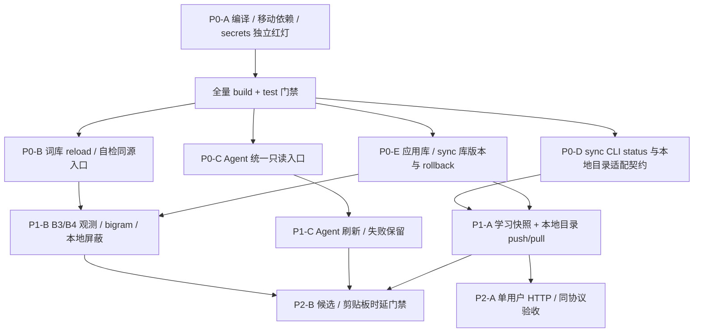

# Clavis 后端施工计划与分批验收

任务：`T-clavis-backend-execution-plan`。基线：`3d92ef4` 及 2026-11-21 本地工作树快照；行号指盘点时读取的代码（并行变动用符号复定位），不表示未提交代码已经发布。本文件只排后端，不改代码；旧路线原文保留，勘误见末节。**先修编译红灯和独立测试红灯，再接入口，最后扩能力。**

## 1. 基线与解锁顺序

| 现状证据 | 已有 / 缺口 / 下一步 |
|---|---|
| `pkg/core/sync/state.go:17–32,41–75` | 客户端 SQLite 状态表已存 watermark 与 recovery_ready；第 66 行 `uint64(^int64(0))` 常量溢出，阻断 `sync` 并连带 `inputmigration`、`internal/storage`、`uiapp`、根 App。P0-A 用 SQLite 有符号 64 位上界比较，转型前校验；用 `0 / MaxInt64 / MaxInt64+1` 证明拒绝越界且原值不变。不要改测试绕过。 |
| `pkg/mobile/mobile_test.go:209–266`；`pkg/core/sync/state.go:8` | 实跑报 `forbidden mygo dependency "github.com/egoist/mygo/internal/i18nlink"`。用 `go list -deps ./pkg/core/... ./pkg/mobile/...` 检查实际依赖闭包；已确认 core 直接依赖 MyGo SQLite，不能只屏蔽诊断。把状态 SQL 放 `internal/storage`，core 依赖下述窄接口；清理其余实际引入链后保留原门禁。 |
| `internal/secrets/file_store_test.go:71–88` | `TestLayeredStoreNeverTouchesKeychainWhenMigrationIsOff` 独立失败，`resolve err = <nil>`。先用隔离配置与显式空环境验证文件/环境/迁移开关优先级；缺值语义和禁用迁移时零 Keychain 调用都要保留，不使用机器凭据。不能把它算作 sync 编译的下游。 |
| `pkg/core/inputengine/dictionary.go:248–358`、`selfcheck.go:79–96`、`internal/watcher/dictionary_watcher.go:59–166` | 当前诊断符号已存在；loader、watcher、bridge 的定向测试通过，**当前不存在该符号 undefined 的实证**。不要重新造 loader 或把根 App 无法编译归给 watcher；先清除前述红灯，再用自检及端到端 reload 验实接线。 |

基线在仓库根实跑：`go test ./...` 退出 `1`，关键输出如下（测试红灯是施工输入，不是本次文档交付的通过项）：

```text
pkg/core/sync/state.go:66:24: constant -1 overflows uint64
--- FAIL: TestLayeredStoreNeverTouchesKeychainWhenMigrationIsOff (0.00s)
    file_store_test.go:80: resolve err = <nil>
--- FAIL: TestPureStdlibDependencies (0.06s)
    mobile_test.go:231: forbidden mygo dependency "github.com/egoist/mygo/internal/i18nlink" found in pkg/core or pkg/mobile
```

另实跑 `go test -count=1 ./pkg/core/inputengine ./internal/watcher ./internal/bridge ./pkg/core/agentsession ./internal/agentsession ./cmd/clavis`，六包通过；不把该结果当作运行 App、同步或真机验收。

## 2. P0/P1/P2 依赖图和文件锁



写入所有权按**批次**，不是按包名猜能否并行。P0-A 合入并重新全量测试前，不派任何入口写任务；只可准备临时 fixture 和基准记录。合入后按以下交集避让：

| 不可并写范围 | 施工顺序与可并行边界 |
|---|---|
| `pkg/core/sync/{state,sync,identity,store,server_store}.go`、`internal/storage/sync_sqlite_store.go` | P0-A 先冻结状态接口；P0-D 定 transport / CLI，P0-E 定 schema；两者可分别写 CLI 和迁移，但共享 sync store/接口改动串行。P1-A 等两边都过，才接 apply/outbox；P2-A 最后复用 transport。 |
| `main.go`、`selfcheck.go` 与启动/关闭测试 | P0-E 先提交启动迁移门；P0-B 再接 reload/自检，P0-C 若要注入 adapter 也不在同一批修改 `main.go`。后续指标只消费已冻结诊断快照。 |
| `internal/bridge/input_engine_{keys,host,darwin,windows}.go`、`pkg/core/inputengine/{dictionary,engine}.go` | P0-B 先完成发布/保留语义；P1-B 再共享同一候选策略，bigram 与用户屏蔽不能分别改候选输出；P2-B 在稳定快路径上采样。 |
| `internal/storage/{sqlite_store,learning_store,learning_writer}.go` | P0-E 版本与备份先；P1-A 先定义 WAL/Flush 到快照落地的一致性；P1-B 在其提交后加入屏蔽表和持久化命令，避免两个写者争 `user_version`、镜像发布和 `Flush` 语义。 |
| `uiapp/{agent_sessions,controller}.go` | P0-C 先统一 reader；P1-C 再加代际缓存；P2-B 如需改 controller 的剪贴板事件，等 P1-C 合入。可独立做 `pkg/core/agentsession` fixture，不同时更改共享 UI 契约。 |

## 3. 施工契约（未标「已有」的签名均为拟新增或替换）

### 3.1 P0-B 词库诊断、热更新、自检；P1-B 学习与质量

**现状。** `dictionary.go:135–180,258–358,461–505` 有嵌入 common 和基础层、用户目录 `.clvdict`、显式配置路径与缓存；显式层优先，坏文件按文件跳过。已有 `LoadDictionaryWithDiagnostics(customPaths []string, cacheDir string, report func(DictionaryDiagnostic)) (Dictionary, error)` 当前在部分/全部自定义失败时返回 fallback + `nil`，用户目录诊断与显式诊断仍是两条路径，目录无法读取与不存在可能同态，fallback 标签不反映实际剩余层。`selfcheck.go:79–96` 先读用户目录再走 loader，且只显示用户目录计数；`internal/bridge/input_engine_keys.go:81–107` 用 loader 但丢返回错误，诊断只记日志。`main.go:617–634` 已启动 watcher 并调 `ReloadInputEngine`；`internal/watcher/dictionary_watcher.go:119–202` 轮询摘要/消抖，快照错误静默，范围仅用户目录；`internal/bridge/input_engine_{darwin,windows}.go` 的 `ReloadInputEngine` 是已有平台入口。

**P0-B 接线与错误。** 统一产物，不动现有 loader 签名的调用方兼容层：

```go
// pkg/core/inputengine；纯 Go，未发布快照仍可继续用旧版本。
func ResolveDictionary(ctx context.Context, req DictionaryLoadRequest) (DictionarySnapshot, error)
// req: UserDir, CustomPaths, CacheDir；snapshot: Dictionary, Layers, Diagnostics, Digest。
// internal/bridge；由后台 worker 解析和编译，发布只做短锁交换。
func (m *DictionaryManager) Reload(ctx context.Context, cfg config.InputEngineConfig) (ReloadResult, error)
```

诊断项 `sourceID, kind, fallback, count`，`kind=unreadable|invalid_format|invalid_fields|empty|cache_write`；无目录且未配置为正常内嵌，无权限不是无词库。保留现存失败类型的兼容映射。显式路径、用户目录和配置变更进入一个去抖队列；使用读取的同一份 bytes 校验、hash 和编译，避免双读竞争；缓存键含格式版本和 digest。单文件损坏、临时半写：启动跳过该层，运行保留该层最后有效快照并标 `stale`；确认删除则移除这一层、回退其余层，禁止永久保留已移除词。全部自定义失败仍服务内嵌；无可用内嵌、取消或发布失败才返回硬错误，不覆盖旧引擎。generation 防慢 reload 覆盖新值；有 preedit 时提交/取消后切换，不丢用户输入。自检走同一个解析结果（dry-run/临时缓存），输出层级、数量、digest 与退化原因，不输出原词、绝对路径或词库内容。Hook 不触文件、网络、DB。

**P1-B 能力边界。** B3 已有 `CandidateRecord` / `ResolveCandidate`（`dictionary.go:34–104`）及稳定优先级测试；不可由 helper 单测推断运行链全部用它（生产命中须从实际候选验证）。`engine.go:825,849–860,1044` 已有 bigram 生成与加权；`learning_store.go:212–298` 提供 RAM 前缀读取，`learning_writer.go:183–217,289–353,400+` 已有异步批处理、flush/retry/stats。B4 `MergeLearning` 已实现，跨机快照在 §3.2。此批只测真实 bridge 数据路径的同音来源优先、pinned、bigram 冷启动逐字节一致和禁用学习不读不写；若发现 resolver 未贯通，只接现有 resolver，不引入第二套排序。

`pkg/core/inputengine/data/blocklist.txt` 和 `scripts/build-common-dict.sh:6` 是**构建期**过滤；`engine.go:121,233–267` 与 `internal/bridge/input_engine_host.go:44–56` 已有运行态屏蔽和重载保留，未见持久化入口。P1-B 新增 `ListBlockedWords(ctx) ([]string, error)` / `SetWordBlocked(ctx, word string, blocked bool) error`，用应用库 `ime_blocked_words` 表、规范化词键且幂等；本地屏蔽对全部候选来源生效（包括 pinned/bigram），不删除学习记录，不默认同步。写入成功后发布 RAM 快照；失败返回 `blocked_word_invalid|storage_failed`，保持原快照。迁移见 §3.4。将首页命中样本冻结为独立 200 条 fixture，保留既有日常词用例；建议验收 ≥180/200，词表先定、不得为过门槛事后删坏例。

### 3.2 P0-D 同步入口；P1-A 本地目录两端联通；P2-A HTTP

**现状。** `pkg/core/sync/sync.go:29–97,489–637,834–922,960–1088,1139–1229,1324–1444` 已有 v2 AES-GCM/Ed25519、设备配对、ADK/X25519 包装、恢复码确认、数据类与 tombstone。`Client` 仍绑 `*Server`；`Sync()` 是拉删除记录、清理、确认，**不是对象 pull**。`pkg/core/sync/store.go:12–29`、`server_store.go:12–105` 有存储边界和内存 adapter；`internal/storage/sync_sqlite_store.go:301–445,907–977` 有持久化、对象版本/墓碑边界，但现有 `SyncStore` 不提供账户对象枚举/增量页，也未覆盖 ADK 包装与恢复接口。`state.go:41–75` 是非秘密状态，`identity.go:62–111` 走 `APIKeyStore`；不能据此宣称配对材料、服务签名、删除确认或 ADK 已跨进程完整持久化。`cmd/clavis/main.go:29–71,159+` 未路由 `sync`。

**P0-A/P0-D 接口。** Core 注入 `DeviceState { Load(context.Context) (uint64, bool, error); Save(context.Context, uint64, bool) error }`，实现移入 `internal/storage`。保留旧 in-process 构造作为 adapter 测试入口；新增 `NewClientWithTransport(t Transport, id DeviceIdentity, state DeviceState) (*Client, error)`，不是给 CLI 直接用内存 `NewServer()`。`Transport` 分成鉴权/配对/取设备公钥、签名 envelope 上传与下载页、签名 tombstone 拉取与确认为一组；同时显式覆盖 X25519 公钥、wrapped ADK 及 recovery wrap/salt，SQLite 服务端实现须验证重启保留所需状态。核心方法：

```go
Push(ctx context.Context, envelope EncryptedEnvelope) error
Pull(ctx context.Context, after ObjectCursor, limit int) (EnvelopePage, error)
PullDeletes(ctx context.Context, after uint64) (TombstonePage, error)
AckDeletes(ctx context.Context, batchID string, through uint64) error
```

账户和设备身份由已认证会话绑定；对象 cursor 与 tombstone watermark 分开，分页稳定、校验签名与账户/类/版本，禁止把 tombstone watermark 当通用对象页游标。`clavis sync status --json`（全局 flag 位置按 `parseGlobalFlags` 登记并测试）P0 只读、离线可用，显示 configured/enabled、recovery_ready、待处理量与 cursor；未接传输时 `init/push/pull` 不回伪成功。P1 开放 `init`、`push`、`pull`；初始化只向用户安全界面交付一次恢复码，非交互时无安全输入/输出通道即拒绝。退出码拟定：`0` 成功（含无变化），`2` 用法/配置错误，`3` 未初始化/未授权/未确认恢复码，`4` 可重试传输或 busy，`5` 拒绝签名/版本/类或需明确解决冲突；JSON 只输出稳定 `code`、计数和 cursor，不输出秘密/明文。

**P1-A 数据与迁移。** CLI 首批 allowlist 仅 `input_method`、`learning_data`，默认关闭联网和后台定时，不能继承 `DefaultSyncPlan()` 对剪贴板/媒体/应用上下文为 true 的默认。`clipboard_text`、`media`、`application_context` 不接；`sensitive_vault` 独立授权且本计划不开；`passwords`、`key_manager` 永不走同步；设备 overlay及绝对路径、权限、Agent 会话、原文 prompt 历史均不随 baseline 转移。V2 已部署数据只通过现有版本解析/显式兼容验证升级，不用 `compatibilityADK` 解真实生产对象、不静默生成替换密钥。状态文件/数据库不存私钥、ADK 明文和恢复码。

本地目录方案：设备只原子发布自己的不可变、签名密文对象文件（同目录临时文件 → fsync → rename），**不把活 SQLite/WAL 放共享盘**。第一版以一个授权协调端维护配对、全局墓碑序号、删除批次和版本边界（本机私有 SQLite）；普通设备不能直接改共享全局索引或签发服务 tombstone。目录传输不把 OS 权限当签名验证；限定名称、大小和账户范围，拒绝路径穿越、符号链接和未完成文件。共享盘延迟/乱序时可重试，不承诺即时一致。

下载先验签、解密、校验和预览，再通过本地事务应用；先持久化删除与不可复活边界（清理对象、缓存/媒体及可管理的备份/导出索引），再应用允许的上传页。持久化 `pending_ack` 后仅对原 issued batch 确认，确认成功才推进已确认 cursor；崩溃后按批次/对象 ID 幂等恢复，远端已确认但本地未记账时需查询/重试同一批确认，不盲跳序。`ErrStoreDeleted` 不复活，`ErrStoreVersion` 保留获胜版本和冲突摘要，`ErrStoreBatch/Cursor` 触发受控重同步不从零覆盖，验签/无权直接拒绝。同步不阻塞输入和关闭流程；后台状态可见，不静默吞错。

**B4 学习和冲突。** `pkg/core/inputmigration/migration.go:59–85,834–880,1138–1189` 已有摘要、严格序列化与 `MergeBaselines` 字段 revision 决议（同 revision 不同值现在偏 target，不对称）；`merge.go:23–44,52–134,181–194` 已有 digest 键、排序、pinned OR 和未 pinned 压缩，当前求和是饱和保护，不是旧设计文字的错误返回。`MergeBaselines` 的 learning 分支仍以获胜快照替换，不自动调用 `MergeLearning`。P1 新增 `ExportLearningSnapshot(ctx, deviceID) (LearningSnapshot, error)` / `ApplyLearningSnapshots(ctx, snapshots []LearningSnapshot) (ApplyReport, error)`。设备发布带单调 revision、内容 digest 的**原始本地贡献**；导入事务以 `(account,device,revision,digest)` 去重、仅接受每设备的新版本，在稳定顺序下从所有设备最新原始贡献聚合，**只压缩一次**，不反复把已压缩结果当原始输入再合并；多设备先全量累加再统一修剪，超上界在应用层拒绝（不回绕），pinned 不压缩、不淘汰。汇总内容不得伪造反向映射；词/读音需要时仅在授权加密快照内传，摘要型旧快照只进摘要。`Flush` 到同一快照水位后导出、事务应用后刷新镜像；未提交不能回写发布。个性 baseline 同版本冲突由协调端用固定比较键 `(revision, deviceID, digest)` 决议，保留冲突摘要；不直接把方向相关 `MergeBaselines` 当任意两端可交换 CRDT。删除边界优先于 merge。

**P2-A HTTP。** 单用户 HTTP adapter 与目录跑同一 conformance suite；私有根目录、持久化 store、受限页大小/请求体、deadline、TLS（仅 loopback fixture 可无 TLS）；账户鉴权、版本/光标/重试语义不分叉。提供 `NewHTTPHandler(store SyncStore, auth Authenticator, keys KeyEnvelopeStore) http.Handler`，不用 `NewServer()` 冒充可重启的服务。端到端只传签名密文；日志只保留请求 ID/状态码/耗时/数量。默认无 HTTP 监听，不接设置 UI 或公网部署。

### 3.3 P0-C Agent 入口与 P1-C 刷新

**现状。** `pkg/core/agentsession/model.go:20–65,68–139` 有 Session/Diagnostic/Options 与注入 `CodexThreadsReader`，DSH、Codex、Claude 并发，provider deadline 最多 500 ms，错误以诊断返回；对忽略 context 的 reader，当前汇总只等 channel 或父 context（单独派生 provider deadline 不会主动回收这个结果位）。`sanitize.go:17–41` 已有预览脱敏，`agentsession_test.go:24–100` 有 provider 隔离用例。`internal/agentsession/codex_sqlite.go:16–105` 已有 SQLite 插件只读 reader（`mode=ro`、`ReadOnly:true`、100ms busy、最多 500 行、拒绝 `immutable=1`、表/列白名单）；`uiapp/agent_sessions.go:27–78,223` 仍走 `sqlite3 -readonly -json` 子进程，有 RAM 缓存和 in-flight guard；`uiapp/controller.go:485,802` 已触发后台发现。不是从零接 Agent tab。

**P0-C。** 复用 `CodexThreadsReader.Threads(ctx context.Context, limit int) ([]CodexThread, error)`，在平台 composition root 注入插件 reader 或显式 `unavailable`，移除 UI 的子进程旁路。绝不打开 Codex DB 为写、迁移、checkpoint、改 journal、设置 immutable 或复制无 WAL 的活文件；读锁/busy 原样分类为 `busy`，表结构不足为 `incompatible_schema`。优先验证真实路径转义 (`? # %`)、WAL 活记录、无写权限读以及 DB 字节/mtime 不被变更；测试只用临时 DB。Core 不 import MyGo。

**P1-C。** 拟 `Snapshot() AgentSnapshot`、`Refresh(ctx context.Context, reason RefreshReason) (AgentSnapshot, error)`；每 provider 只允许一个在飞请求，父服务 deadline 和每路结果 deadline 分开；不合作 reader 的迟到结果丢弃、未退出前不重复启动。启动后台首刷、进 tab 缓存超过 30s 才刷新、手动刷新合并在飞；离开/退出可取消，以 generation 验证发布。每路保存 sanitized sessions、lastAttempt/lastSuccess、stale 和诊断，失败保留该路最后成功结果并标 stale（TTL 建议 5 分钟；过期只留诊断），其他 provider 仍更新；首次无数据与失败分开。成功空列表才清该路缓存；错误码 `unavailable|timeout|busy|incompatible_schema|read_failed`，仅总体取消可作为调用错误，provider 失败不抹掉其他数据。无 SQLite 迁移、无磁盘缓存、无 Agent 数据同步。

### 3.4 P0-E 数据迁移、备份与启动回滚

**现状。** `main.go:308–332,1968–2012` 为桌面入口与关闭，`clipboard.db` 先开剪贴板，再用同一 DB 构造 LearningStore/Writer；`internal/storage/sqlite_store.go:34–60,87+` 初始化 WAL、表、FTS/trigger；`learning_store.go:17–39,82–157` 用 DDL 自动建表+全量镜像载入，无统一版本。`sync_sqlite_store.go:398–496` 有旧 tombstone 迁移、旧表保留和 `PRAGMA user_version = 1`，但不先校验当前版本并且 schema 初始化和设版本并非同一迁移事务；`pkg/core/sync/state.go:17–32` 是独立客户端状态库。不能对这三类 DB 用同一个版本号含义，更不能递增只读的 Codex 库。

**策略与接口。** 拟 `Migrate(ctx context.Context, path string, kind DBKind) (MigrationReport, error)`、`Backup(ctx context.Context, kind DBKind, dst string) (BackupManifest, error)`、`ExportLearning(ctx context.Context, w io.Writer, format ExportFormat) error`。按 DB kind 注册迁移链：（1）`clipboard.db` 的 v0 覆盖空库与历史未标版，用表/列/索引/FTS 检查辨别；v1 纳管当前剪贴板、学习、频率及历史表；P1 屏蔽/快照 ledger 进入后续独立版本。（2）sync 服务库区分未标 legacy、现有 v1、损坏/未知；保留 append-only tombstone、current boundary、issued batch 和账户游标；v2 才增加配对/包装所需元数据。（3）设备状态库纳管 watermark、recovery_ready 及之后的 pending_ack，分路径、不同版本注册。`FromDB` 如果借用其他库不得改全局 `user_version`；启用正式迁移必须有专用库，否则拒绝并给出分库步骤。

启动先锁独占迁移、读取 `user_version`、检查实体结构、创建可读回验的备份，再开放写者与任务。使用 MyGo SQLite 插件的 `DB.Transaction(ctx, []sqlite.Statement)` 承载可交易的 DDL/数据/版本写入，不用 `Execute("BEGIN…")` 绕 authorizer；先用 fixture 验 `PRAGMA user_version=N` 可同事务执行和故障回滚。若驱动不允许，不能退成分句落原库：改在独占的 staged DB 上写并校验，关闭后原子替换。WAL 配置放事务外；备份用插件能力验证通过的在线一致性快照，缺接口则暂停写入/Flush/关闭连接、确认 WAL已合并后才复制；禁止活库直接拷主文件。备份和导出使用私有权限、临时文件、digest manifest、校验后原子发布；不默写明文学词/剪贴板到共享位置。JSON 是带版本/摘要的显式导出，Rime 仅词频投影（明确不能恢复状态、密码、prompt、bigram 等）。

错误契约：`schema_too_new` 禁止写和降版；`backup_failed|migration_busy` 保留原库、不启动会写库的服务；`migration_failed` 回滚且保留备份，恢复仅在关闭连接、校验 manifest 并保留失败现场后原子替换；`integrity_failed` 禁止用空 DB 覆盖。App 可显示只读/受限模式并说明哪些能力不可用，不能把当前剪贴板 SQLite 失败后的 RAM fallback 显示为持久化成功。第二次启动已达目标版本不重跑；旧版应用启动新库应拒绝。客户端本地备份恢复后重新核对远端 tombstone 边界，不能复活对象。

### 3.5 P2-B 延迟、剪贴板切换与诊断

**现状。** `pkg/core/inputengine/engine_bench_test.go:10–68`、`pkg/core/ime/ime_bench_test.go:5+` 测核输入；`uiapp/frame_bench_test.go:154+` 测候选渲染；`uiapp/clipboard_switch_bench_test.go:25–68` 先打开剪贴板并预载 50 行，计时内只做上下键 selection + frame（typical / 大文本），**不测冷切 tab 首帧**；`uiapp/controller.go:2098,2262–2277,2398–2435` 已有剪贴板 generation 边界，`selfcheck.go:44–159` 已报运行配置和权限但无统一状态快照。

**入口/契约。** `DiagnosticsSnapshot(ctx context.Context) (Snapshot, error)` 聚合已发布的内存状态：词库 digest/层数/退化、学习 writer flush/retry/drop、sync 成功/待提交/冲突数、Agent per-provider status 和阶段延迟，CLI 文本/JSON 读同一结构。仅已允许的汇总量，不存按键、候选词、剪贴板内容、Agent 消息、绝对路径或凭据；默认本地关闭持久采样，禁用时近零开销，采样队列满可丢并计数。可用状态区分 `not_run|disabled|stale|degraded|error`，无样本非 0。读诊断不触发新扫描、同步或迁移。

同机同电源条件固定型号/GOOS/Go/MyGo 版本、字典 digest、典型与大文本 fixture，采五次预热后的 `benchmem` 中位数；对候选 benchmark 和剪贴板选中切行 `ns/op` 相对基线 ≤1.20，allocs/op 不增，基线未冻结前不称达标。新端到端量测拆开「按键→候选首可见帧」「切到剪贴板→首帧 skeleton」「→首个可用列表」；每场景 ≥200 样本 report p50/p95，建议温缓存候选/切换首帧 p95 ≤16.7ms（60Hz 单帧），冷加载可用列表 p95 ≤100ms，首次标准机测量需单独留证。慢盘、坏词库、provider 卡死不阻塞按键；failed gate 单列原因，不放宽到只看平均值。

## 4. 分批验收与交接

均在仓库根执行；`-run` 针对新增用例的批次必须先用 `go test -list` 核对**每个**命名存在，再 `-v` 检查 `=== RUN` 和 `PASS`，不能用匹配零用例的 `ok` 过门槛。新用例下列名字是**施工待补**，不声称已存在。全部用临时目录、无真实 Keychain/Codex/剪贴板/同步账户；HTTP 使用本地测试服务器。平台自检仅在专用测试配置/用户下跑。

| 批次和入口门槛 | 独立验收命令 / 预期证据 |
|---|---|
| **P0-A** 修红灯 | `go build ./...`；`go test -count=1 ./pkg/core/sync ./internal/storage ./pkg/core/inputmigration ./internal/secrets ./pkg/mobile`；`go test -count=1 ./...`。保留 `TestPureStdlibDependencies` 与 secrets 原行为，新增 `TestStateWatermarkSQLiteRange`。保存 `go list -deps ./pkg/core/... ./pkg/mobile/...` 的无 MyGo 断言及正向包列表，不只跑一组已缓存测试。 |
| **P0-E** 迁移启动门 | `go test -count=1 -v ./internal/storage -run 'TestSQLite(StoreRestartRestoresProtocolState|SyncStoreContract|MigrationLegacy|MigrationFutureVersion|MigrationRollback|MigrationWALBackup)'`；`go test -count=1 -v . -run '^TestStartupMigrationFailureDoesNotStartWriters$'`。预期旧库/新库/重启同账、注入失败时 DDL 与版本一起回滚、WAL 中最后写入仍在备份、未知版本未修改、失败不启动持久写者。 |
| **P0-B** 词库接线 | `go test -count=1 ./pkg/core/inputengine ./internal/watcher ./internal/bridge`；`go test -count=1 -v . -run '^TestSelfCheckDictionarySnapshot$'`；隔离 HOME/测试用户运行 `go run . --self-check`，保存 layer/digest/diagnostic 输出；正常 fixture 新增→损坏→恢复→删除的集成测试命名 `TestDictionaryReloadKeepsLastGoodAndDropsDeleted`（放 `internal/bridge`，要求 `=== RUN`）。 |
| **P0-C** 只读 Agent | `go test -count=1 -v ./pkg/core/agentsession ./internal/agentsession ./uiapp -run 'Test(DiscoverProviderFailureDoesNotHideOtherProviders|CodexSQLiteReader.*|AgentTabRendersCachedSessionAndDiagnostic|AgentUsesInjectedCodexReader)'`。插件 reader 而非系统 sqlite3；活 WAL、busy、未知 schema 和拒绝 immutable 均有具名测试，绝对不写第三方 DB。 |
| **P0-D** CLI status / 传输边界 | `go test -count=1 -v ./cmd/clavis ./pkg/core/sync -run 'Test(SyncCLIStatusOffline|TransportRejectsUnauthorized|TransportStoreConformance)'`；隔离配置执行 `go run ./cmd/clavis --config-dir "$test_config_dir" --json sync status`（`test_config_dir` 为 `mktemp -d` 创建的 fixture 目录），返回 `configured:false`，无外部连接/密钥创建；命令内 `push/pull` 未开放即报清楚，不回 0。 |
| **P1-A** 学习与目录联通 | `go test -count=1 ./pkg/core/inputmigration`；`go test -race -count=1 -v ./cmd/clavis ./pkg/core/sync ./internal/storage -run 'Test(SyncDirectoryTwoDevices|LearningSnapshotReplayAndConvergence|SyncDeleteCrashRecovery|SQLiteStoreRestartRestoresProtocolState)'`。两设备各自配置/存储，上传同词不同计数，按两种到达顺序重放、三设备补测不重复压缩，双端 digest 一致；重启与 ack 中断不复活、跨账户及禁用数据拒绝；不需要第二台真机才验证协议。 |
| **P1-B** 候选和屏蔽 | `go test -count=1 ./pkg/core/inputengine ./internal/bridge ./internal/storage`；其中要求 `TestBigramGenerationAndColdStartSnapshot`、`TestUserBlockedWordsAreRemovedAndCanBeUpdated`、新增 `TestBlockedWordSurvivesRestart` / `TestDictionaryFixtureTopPage200` 实跑。报告命中数量、端到端候选来源、关闭学习无写入、屏蔽重启保持。 |
| **P1-C** Agent 刷新 | `go test -race -count=1 -v ./pkg/core/agentsession ./internal/agentsession ./uiapp -run 'Test(DiscoverProviderFailureDoesNotHideOtherProviders|AgentRefreshPartialStale|AgentRefreshDeadlineAndGeneration)'`。伪时钟、坏 provider 和忽略 context reader，健康数据不消失、迟到结果不覆盖、关闭后不回写。 |
| **P2-A** HTTP | `go test -race -count=1 -v ./pkg/core/sync ./internal/storage ./cmd/clavis -run 'Test(TransportStoreConformance|SyncHTTPTwoDevices|SyncHTTPDeleteRestart|SyncHTTPUnauthorizedAndLimits)'`。目录/HTTP 同一 fixture 和错误映射，签名无效/重复页/禁止数据类/重启完整验证。 |
| **P2-B** 性能与观测 | `go test -run '^$' -bench 'Benchmark(EngineKeystrokeQuanpin|ComposerKeystroke|FrameCandidate|ClipboardSwitch)$' -benchmem -count=5 ./pkg/core/inputengine ./pkg/core/ime ./uiapp`；新增端到端 `TestCandidateFirstFrameLatency` / `TestClipboardTabFirstUsableFrame`，用 `go test -count=1 -v ./uiapp -run 'Test(CandidateFirstFrameLatency|ClipboardTabFirstUsableFrame)$'` 记录样本和阶段 p95；`go test -count=1 -v . -run '^TestDiagnosticsSnapshotNoPrivateData$'` 守隐私。 |

每批记录基线 commit、平台、命令、关键输出、样本/数据版本和剩余失败。P0 后每次跨接口变更重新跑 `go test -count=1 ./...`；发布前再跑 `go build ./...` 加两类启动（现有库升级与新库冷启动）。Windows 真机无设备时记为未验，不以 macOS 用例替代。

## 5. 旧路线勘误（对应 `docs/design/backend-roadmap.md`）

| 旧条目 | 当前代码纠正 / 排程调整 |
|---|---|
| §0「同步引擎测试全过」，§1.1「引擎完整、只接 host」 | 当时结论不可外推；现在 state 编译阻断，ADK/恢复包装已推进但需持久化和 transport contract，`Sync` 只拉删除，没有对象页和安全落地事务。入口确实未接，先 P0-A，再 CLI status/adapter，不直接开 HTTP。 |
| §1.2、§4 B1「仅内嵌，新增 watcher」 | `LoadUserDictionary` / diagnostics / watcher / `ReloadInputEngine` 已在工作树。P0-B 修的是活路径、明确失败与缺失、自检同源和热切换一致性。 |
| §2.1、§4 B2「没有 MergeLearning」 | `pkg/core/inputmigration/merge.go:33` 与定向测试已存在；约束是 pairwise 确定性，不是 replay 幂等，且 `MergeBaselines` 不进行学习 union。补多设备原始贡献聚合和事务。 |
| §2.2、§4 B5「bigram 只排序/需造生成器」 | `engine.go:849` 已生成，`unify_test.go:324` 有冷启动及上下文用例；P1-B 保证 bridge 到 RAM 学习数据真实接通、避免性能和排序退化。 |
| §2.3 「没有用户屏蔽」 | 运行态屏蔽已有，缺本地持久存储/重启和来源全覆盖测试。构建黑名单与用户屏蔽是不同层。 |
| §0/§4 入口盘点未计 Agent | Agent tab、缓存与只读 core 模型已接；当前 UI reader 仍是 subprocess、插件 reader 另有实现，先统一入口再分 provider 刷新契约。 |
| §3「SQLite 无 schema 版本」，§4 B9 可独立并行 | sync 服务库已有 `user_version=1` 和旧墓碑变换；应用共库与设备状态未统一迁移。迁移是上线写入口前置，不是晚做的清理。不能并改 `main.go`、`learning_store.go` 和 sync 状态契约。 |
| §3 帧时门槛与 §6「失败静默」 | 现有 benchmark 同时区分候选核耗时、候选画帧和预载后的剪贴板选中，缺冷切到首可用帧；P2-B 按独立窗口测量。后台失败不打断输入，但要出具状态/诊断，不能用空结果冒充成功。 |
| §1.3、§2.4–2.5 | Windows 实测、AI 续写/探测不纳入本次施工序列；保留旧路线条目，待有独立任务与平台资源再排。 |
