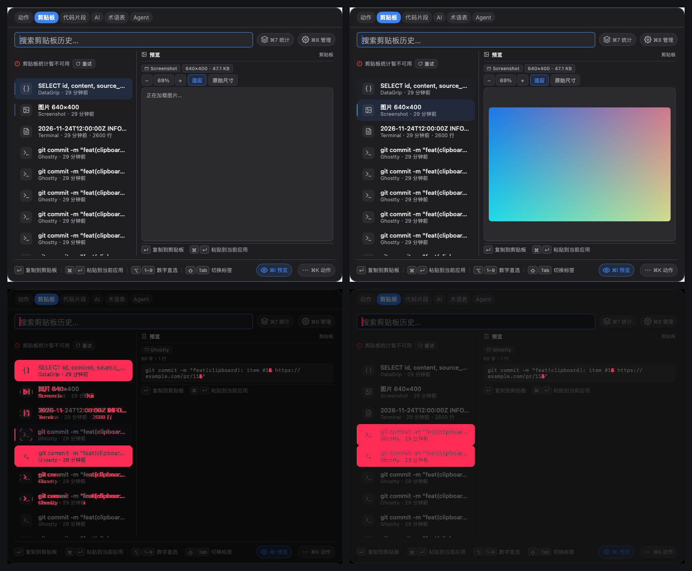
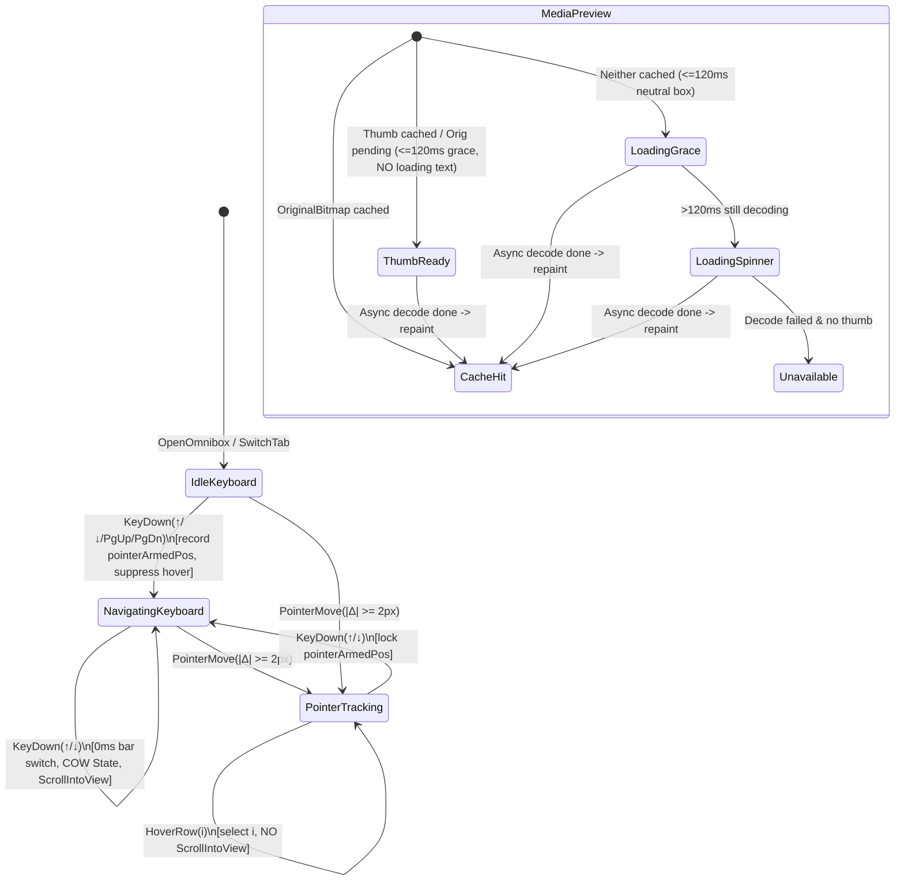

# 剪贴板上下切换卡顿与闪烁：真渲染复现、根因诊断与施工设计

> **Status: Superseded / Updated as of 2026-11-25** — 方案 B 全部 4 个施工批次现已全量合入 `main`（`85cfa27`、`4daa15d`、`fe21df5` 及 `CLV-P1-4` `79d325b`：COW Capsule 状态、行元数据与预览缓存、60 行预览上限，达成 120Hz 预算）。详见 [`docs/ROADMAP.md`](../ROADMAP.md)；本文保留作性能剖析与真渲染对比基线记录。

> 任务号：`T-clavis-clipboard-jank-visual`（Spec / 诊断设计阶段，本轮不改实现代码）
> 复现环境：macOS arm64 (Apple M4), MyGo `ui.NewTester` 真渲染 + `BenchmarkClipboardSwitch` + `go tool pprof`

---

## 一、问题定义

### 1.1 问题是什么
用户在 Capsule Omnibox 的剪贴板（Clipboard）标签页中按 `↓` / `↑`（或 `Ctrl+N` / `Ctrl+P`、长按方向键连发）切换历史条目时，会出现明显的三类复合劣化：
1. **整列文字抖动/闪烁**：每切一行，未选中的旁观行字形与图标整体做亚像素重采样抖动；同时新旧选中行在 80ms 内出现「双蓝条重影」与「右预览已切换、左高亮滞后 1–2 帧」的撕裂感。
2. **滚动回弹跳闪**：当鼠标指针静止停留在列表上方、键盘 `↓` 触发 `ScrollIntoView` 滚出视口时，选中项会突然被静止指针向后拉回几行（实测直接从 row 9 弹回 row 4）。
3. **跨类型预览闪白/卡顿**：切到图片条目瞬间先闪出 `"正在加载图片…"` 空画布（120ms+），再弹出图片；切到 256 KiB 长文本日志时单步帧耗时达到 **14.4–16.7ms**（Apple M4 上即逼近 60Hz 掉帧线、直接击穿 120Hz 8.3ms 预算）。

### 1.2 谁受影响 & 现在怎么凑合
- **受影响人群**：所有使用默认视觉预设（`visual_preset = "spatial_3d"`, `oblique_rows = true`, `animations = "auto"`）的 macOS / Windows 桌面用户，尤其是高频键盘切选剪贴板历史的重度用户。
- **当前凑合方式**：手动将设置切到 `classic` 且关闭动画，可消除旁观行抖动，但仍无法解决静止鼠标滚动回弹、切图 120ms 加载闪烁以及 256 KiB 长文本 16ms 卡顿与每步 1.27–1.70 MB 内存分配。

### 1.3 为什么现在必须解决
- 剪贴板历史是 Clavis 最高频交互面之一，上下切换的「跟手度」直接决定产品口碑。
- 本轮先形成**可直接照单施工的设计契约与验收门槛**，避免与并行 Codex 修复任务同时改 `uiapp/` 产生冲突，也避免只凭直觉「关掉某个特效」治标不治本。

---

## 二、现状证据

所有结论均由仓库当前 `main`（`28e6b70`）代码定位、基准测试、CPU/Alloc 剖析与真渲染逐帧像素差实测得出。

### 2.1 实测基准与 `pprof` 热点（Apple M4）

执行命令：
```bash
go test -run '^$' -bench BenchmarkClipboardSwitch -benchmem -count=3 ./uiapp/
go test -run '^$' -bench BenchmarkClipboardSwitch -benchtime=1s -cpuprofile=/tmp/clavis_clip_switch.prof -memprofile=/tmp/clavis_clip_mem.prof ./uiapp/
```

实测结果：
| 场景 | 单步耗时（ns/op） | 单步分配字节（B/op） | 单步对象数（allocs/op） | 120Hz (8.3ms) 预算状态 |
|---|---:|---:|---:|---|
| `BenchmarkClipboardSwitch/typical`（50 条短文本） | **11.0–12.3 ms** | **1.27 MB** | **6,967–6,973** | 超预算 **1.45×** |
| `BenchmarkClipboardSwitch/large`（含 256 KiB 日志） | **14.4–16.7 ms** | **1.70 MB** | **7,279–7,281** | 超预算 **2.0×**（触及 60Hz 悬崖） |

`pprof` Top 热点（实测原数据）：
- **Alloc Space Top（总分配 355.82 MB）**：
  1. `pkg/core/engine.cloneState`：**185.58 MB（52.15%）** — 每次 `EventSelectNext` 在 `uiapp/controller.go:967,984` 与 `uiapp/capsule_view.go:33` 多次调用 `State()` / `Handle()` 深拷贝完整 `OmniboxItems` / `ClipboardEntries` / `InstalledApps` / `FrecencyScores`。
  2. `mygo/ui.(*context).alloc`：**32.16 MB（9.04%）** — 每帧全量重建列表与预览元素树。
  3. `uiapp.previewLines`：**12.54 MB（3.52%）** — `uiapp/capsule_preview.go:500,734-768` 每帧切分并生成最多 **200 个** `.Wrap()` 文本元素。
  4. `uiapp.(*AppController).renderCapsuleHeader`：**11.51 MB（3.24%）**。
  5. `uiapp.buildHighlightedSpans` + `ui.encodeSpans`：**14.50 MB（4.08% cum）**。
  6. `ui.Transform.Then` + `ui.Translation3D` + `ui.RotationY`：**13.00 MB（3.65%）** — 来自每行 3D 变换矩阵。
- **CPU Top（总采样 4.49s）**：
  1. `mygo/internal/raster.(*renderer).effect` + `plugins/glass.(*pixels).Color` + `BackdropImage.Sample`：**1.20s（26.73% cum）** — Liquid Glass 玻璃着色器在每次选中变化与 80ms 动画帧上全屏重算。
  2. `mygo/internal/raster.(*renderer).transformedGlyphs` + `transformedCoverage`：**0.53s（11.80% cum）** — `stageRowTransform` 触发的 3D 透视文字光栅化。

### 2.2 五个独立「丑因」与精确代码位置

| 编号 | 现象（用户体感） | 精确代码定位 | 真渲染 / 实测证据 |
|---|---|---|---|
| **RC-1** | **整列旁观行字形亚像素抖动（最大视觉闪烁源）** | `pkg/core/config/main_config.go:159`（默认 `VisualPreset = "spatial_3d"`）、`uiapp/stage.go:80-82,134-153`（`stageRowPose`）、`uiapp/stage_row.go:26-37`（`stageRowTransform`） | 选中行从 row 3 → row 4 时，所有 `\|i-selected\| ≤ 6` 的非选中行都按 `RotateY(delta*1.2)` + `TranslateZ(-delta*2)` 重新倾斜，而 `i == selected` 突然跳过变换回退到 2D 恒等矩阵。实测下方旁观行（row 5..8）像素变化 **1,639 / 46,206 px（3.5%）**，而在关闭斜排或 `classic` 下为 **0 / 46,206 px（0.0%）**，且首帧耗时从 **12.18ms 降至 6.68ms**。 |
| **RC-2** | **左蓝条滞后 1–2 帧 + 新旧行双蓝条重影（左右撕裂）** | `uiapp/capsule_view.go:737-746`（`row.AnimateColor("row-sel", fill, selAnim)` 与 `"row-bar"`）、`uiapp/animation.go:61,73`（`selHighlight = 80ms`） | 实测 `↓` 从 row 0 → row 1：<br>- `t=0ms`：右预览已切至 row 1，但左蓝条 `row0_blue=52, row1_blue=0`（完全滞后）；<br>- `t=33ms`：`row0_blue=48, row1_blue=0`（两行同时半亮重影，见对比图左上）；<br>- `settled`：`row0_blue=0, row1_blue=52`。<br>更糟的是 `ui.Row` 没有稳定 `.Key(item.ID)`，且 `Transition(rowEnterAnimation(i))` 挂在每行上，列表过滤/重排时进一步叠加进场位移。 |
| **RC-3** | **滚动出视口时，静止鼠标把选中项强行弹回（跳行闪烁）** | `uiapp/capsule_view.go:678-683`（渲染中调用 `ScrollIntoView`）、`uiapp/capsule_view.go:795-802`（`row.Hovered()` 调 `hoverSelect`）、`uiapp/controller.go:919-943`（`hoverSuppressed` 仅记录旧 `hoverRow` 索引） | 真渲染复现实测：`pointer=(120,280)` 静止停在 row 2 上，连续按 `↓` 到第 7 步时：<br>`step7: 8 -> dispatch(9) -> frame_bounced_to(4)`！<br>根因：`ScrollIntoView(9)` 把 row 4 滚到了静止指针下方；下帧 `row 4` 触发 `Hovered()`，而 `hoverSuppressed` 只屏蔽了旧索引 `row 2`，于是 `hoverSelect(4)` 反手把选中项从 row 9 拉回 row 4！ |
| **RC-4** | **切到图片闪 `"正在加载图片…"` + 文本/媒体切换整树重建** | `uiapp/media_preview.go:244,271-286,311-325`（`originalPreviewDwell = 120ms`，无缩略图时直接显示 `"正在加载图片…"`）、`uiapp/clipboard_media.go:174-180`（`ThumbBitmap` 在 UI 线程同步 `os.ReadFile` + `ui.DecodeBitmap`）、`uiapp/capsule_preview.go:440-452`（媒体用 `ui.Column`、文本用 `ui.Scroll`）、`uiapp/capsule_view.go:857-861`（离开媒体即清零 `mediaPreview` 含 `generation`） | 真渲染复现：`↓` 落到图片行时 `immediate_shows_loading=true`，空框闪烁 120ms+ 后才切为图片（`after_220ms_shows_loading=false`）；且从文本切媒体会销毁重建 `ui.Scroll` ↔ `ui.Column` 容器子树。 |
| **RC-5** | **每步深拷贝 State + 每帧重排 200 行预览与玻璃重绘（12–17ms 卡顿）** | `pkg/core/engine/capsule.go:2334-2370`（`cloneState`）、`uiapp/controller.go:967,984`（两次 `State()`）、`uiapp/capsule_preview.go:496-500,734-768`（全量 `utf8.RuneCountInString` + 最多 200 个 `.Wrap()` 节点）、`uiapp/clipboard_row.go:22-51,85-120`（每可见行每帧算 `time.Now()` + 图标嗅探） | 单步分配 **1.27–1.70 MB / 7,000 allocs**，大文本切换单帧 **16.35ms**；动画帧期间每 16ms 重复执行全部工作并触发全屏 `plugins/glass` 重绘。 |

> **附带发现的隐藏雷区（`uiapp/layout.go:92-113`）**：`PreferredCapsuleSizeForState` 声明了命名返回值 `(width, height int)`，第 100 行写了 `height += int(mediaCanvasHeight - rowHeightOmnibox)`，但第 112 行返回 `return w, h`，导致该增高逻辑目前是死代码。**施工时切勿把 `height +=` 误改成 `h +=`**——否则每次文本↔图片切换都会触发原生窗口高度跳变，引入最恶劣的窗口级闪烁。

### 2.3 真渲染视觉证据（2×2 对比图）



- **左上（`timeline-2-t33ms-midfade.png`）**：按 `↓` 从 row 0 切到 row 1 后 33ms（已过 2 帧）——左列 row 0 与 row 1 同时出现蓝条重影，右列图片预览正闪出 `"正在加载图片…"` 空框。
- **右上（`timeline-3-settled-row1.png`）**：等待 220ms 稳定后的终态——视觉上从空框突变为完整图片。
- **左下（`spatial3d_oblique_full-diff-settled.png`）**：默认 `spatial_3d`（`ObliqueRows=true`）下从 row 3 切到 row 4 的前后像素差热力图（洋红 = 变化像素）——**整列 7 个可见行全部发生亚像素重绘/抖动（旁观行 3.5% 像素变化）**。
- **右下（`classic_off-diff-settled.png`）**：平坦行（无 3D 逐行倾斜）下完全相同的 row 3 → row 4 切换——**仅 row 3 与 row 4 变化，其余所有旁观行 0.0% 像素变化**。

---

## 三、方案对比（3 个方案）

| 维度 | 方案 A：最小止血（仅关动画与斜排） | 方案 B：分层止血 + 热路径缓存 + 交互状态机收口（**推荐**） | 方案 C：全量重写虚拟滚动器 + 独立合成层 |
|---|---|---|---|
| **怎么做** | 将 `ObliqueRows` 默认改为 `false`、`selHighlight` 改为 `0ms`，并把 `hoverSuppressed` 改为键盘模式下忽略 hover。 | 1) **视觉稳定**：列表行在剪贴板/高频列表取消逐行 3D `RotateY` 倾斜（保留面板级 `StageContainer3D` 景深），选中指示条立即响应（0ms 滞后）或由单一平滑滑动指示条承载、稳定行 `.Key`；<br>2) **指针/键盘仲裁**：基于指针坐标 `(lastPointerX, lastPointerY)` 门控 `hoverSelect`（指针未真实移动则绝不抢夺键盘焦点）；<br>3) **预览去闪 + 异步预取**：保持右栏单一稳定容器，图片切换支持「保留上一帧缩略图/柔和骨架延迟展示（≥120ms 未就绪才显 Loading）」+ 相邻行缩略图后台预解码；<br>4) **热路径降本**：`SelectNext/Previous` 走轻量只读/共享不可变 slice 路径免深拷贝、缓存行元数据/图标与预览截断片段（默认首屏 40 行，展开/滚动再渲染余量）。 | 在 MyGo `ui.List` 之外自研带脏矩形局部合成与独立纹理缓存的虚拟列表组件，并为 Glass 背景构建静态离屏帧缓冲。 |
| **改动面** | `uiapp/stage.go`, `uiapp/animation.go`, `uiapp/controller.go`（约 60 行） | `pkg/core/engine/capsule.go`, `uiapp/controller.go`, `uiapp/capsule_view.go`, `uiapp/capsule_preview.go`, `uiapp/clipboard_row.go`, `uiapp/clipboard_media.go`, `uiapp/media_preview.go`, `uiapp/stage.go`（约 350–450 行，可按 4 个独立 commit 拆） | 需深入修改上游 `mygo/ui` + `mygo/plugins/glass` 及 Clavis 大量视图（2,000+ 行，跨仓） |
| **收益** | 立即消除 RC-1（旁观行 3.5%→0%）与 RC-3（鼠标弹回），首帧从 12.2ms 降到 ~7–9ms。 | 一次性根治全部 **RC-1 ~ RC-5**：旁观行像素差 **0.0%**、选中条 **0 帧滞后**、滚动回弹 **0 次**、切图无瞬闪、热路径分配降 **>70%**、Apple M4 单步耗时压到 **<6ms**（满足 120Hz）。 | 理论上可逼近 1–2ms/帧，且 Glass 背景零重绘。 |
| **代价** | 切到 256 KiB 长文本仍达 15–16ms；`cloneState` 仍每步分配 1.27MB；切图仍闪 `"正在加载图片…"` 120ms；视觉上失去行级动态过渡。 | 需要新增小型只读状态视图/行缓存结构体，以及严格的指针坐标门控与图片延迟骨架状态机；Glass 背景仍受 MyGo 软光栅路径限制（非 GPU 合成下仍占固定底噪）。 | 跨仓库改 MyGo 渲染内核，周期以周计，回归风险极高，且阻塞当前并行任务。 |
| **翻车场景** | 大日志剪贴板连按 `↓` 依旧卡顿；图文混排历史上下切换依旧明显闪黑/闪 Loading。 | 缓存失效条件写漏会导致相对时间（"2 分钟前"）或搜索高亮不刷新；若指针坐标未在 `EventOpenOmnibox` 重置，首次鼠标悬停可能漏触发。 | MyGo 升级冲突、高 DPI / macOS Vibrancy 合成撕裂、无障碍与焦点环回归。 |
| **为什么没选它** | **未选方案 A**：只解决 2/5 根因，无法消除切图闪 Loading 与大文本 16ms 掉帧，用户仍会在图文混排/大日志剪贴板里体感卡顿闪烁。 | **✅ 定稿采用方案 B**：改动完全局限在 Clavis 本仓，按 4 个可独立回滚 commit 渐进交付，精准命中 pprof 与真渲染复现的全部 5 个根因。 | **未选方案 C**：投入产出比过低且需跨仓改 MyGo，超出本轮可控风险边界。 |

---

## 四、定稿方案（方案 B）

### 4.1 数据契约

#### (1) 键盘/指针仲裁状态（`uiapp/controller.go` `uiState`）
| 字段 | 类型 | 缺省值 | 权威来源 / 语义 |
|---|---|---|---|
| `inputMode` | `selectionInputMode` (`inputKeyboard` / `inputPointer`) | `inputKeyboard` | 权威来源：最近一次改变选中态的输入源。`EventSelectNext/Previous/SelectIndex` 与翻页键置 `inputKeyboard`；仅当指针真实位移 `\|dx\|+\|dy\| >= 2px` 才切回 `inputPointer`。 |
| `pointerArmedPos` | `ui.Point` | `{0, 0}` | 进入 `inputKeyboard` 时记录当时指针坐标；只有新坐标与该点曼哈顿距离 `>= 2px` 才解锁 `hoverSelect`。彻底替代有缺陷的按行号 `hoverSuppressed`！ |
| `hoverRow` | `int` | `0`（1-based，0 表示无） | 派生视图：仅在 `inputMode == inputPointer` 时生效，避免静止指针在 `ScrollIntoView` 后反抢行。 |

#### (2) 列表行派生缓存（`uiapp/clipboard_row.go`）
| 字段 | 类型 | 缺省值 | 幂等键 | 权威来源 vs 派生视图 |
|---|---|---|---|---|
| `rowMetaCache` | `map[rowCacheKey]cachedClipboardRowMeta`（上限 256，超限清空） | `nil` | `{ItemID, ContentLen, ContentHeadHash, SourceApp, CopiedAtUnix, MinuteBucket, HasMedia}` | 权威来源：`engine.OmniboxItem` + `clipboardClock().Unix()/60`；派生缓存：`IconName`, `LineCount`, `Subtitle`, `HasHexSwatch`, `SwatchColor`。 |
| `previewTextCache` | 单槽 `{ItemID, ContentLen, Limit, Mono, Lines, Hidden, RuneCount, TotalLines}` | 零值 | `{ItemID, ContentLen, Limit}` | 权威来源：当前选中 `item.ClipboardContent`；消除每帧 256 KiB `utf8.RuneCountInString` 与 `previewLines` 重复切分。 |

#### (3) 轻量状态快照（`pkg/core/engine/capsule.go`）
- **问题**：`cloneState` 占总分配的 **52.15%**，因为每次只改 `SelectedIndex` 却深拷贝全部 9 个 slice/map。
- **契约**：`OmniboxItems`、`ClipboardEntries`、`InstalledApps`、`LeaderNodes` 在 `StateMachine` 中改为**写时复制（COW）不可变切片**——只有修改集合内容的事件（`EventUpdateQuery`, `EventSwitchTab`, `EventSyncClipboard`, `EventOpenOmnibox` 等）分配新切片；仅改 `SelectedIndex`（`EventSelectNext`, `EventSelectPrevious`, `EventSelectIndex`, `EventHoverItem`）直接复用同一只读底层切片头（零 slice 拷贝，幂等安全，并发读安全因为底层数组永不原地修改）。

#### (4) 媒体预览去闪契约（`uiapp/media_preview.go` & `uiapp/clipboard_media.go`）
| 字段 | 类型 | 缺省值 | 语义 |
|---|---|---|---|
| `mediaPreviewState.loadingSince` | `time.Time` | 零值 | 开始等待原图解码的时间戳；**在 `120ms` 宽限期内不显示 `"正在加载图片…"` 文本**，保留已有缩略图（若有）或中性占位框，避免瞬时文本闪烁。 |
| `thumbLoading` | `map[string]bool` | `nil` | 将 `ThumbBitmap` 从 UI 线程同步 `os.ReadFile` 改为**后台异步预解码 + 命中缓存即画**；列表选中 row `i` 时自动预热 `i-1, i, i+1` 的缩略图。 |
| `rightPaneContainer` | 固定单一结构 | — | `uiapp/capsule_preview.go:440-452` 无论文本还是媒体，外层统一保留固定 Key 的 `ui.Column` 壳体（文本区在内部固定子槽内滚动），切换 Text ↔ Media 不再销毁重建右栏顶层容器。 |

### 4.2 接口边界与降级行为

1. **`AppController.handlePointerMove(pos ui.Point)` → `hoverSelect(index int, pointerPos ui.Point)`**
   - 输入：行索引 `index` 与当前指针坐标 `pointerPos`。
   - 逻辑：若 `inputMode == inputKeyboard` 且 `|pos.X - pointerArmedPos.X| + |pos.Y - pointerArmedPos.Y| < 2`，直接静默返回（不派发 `EventHoverItem`）。
   - 降级：当测试框架未提供指针坐标（`pointerPos == (0,0)` 且 `pointerArmedPos == (0,0)`）时，`tt.Move(x,y)` 产生非零位移，正常触发悬停选中，兼容全部 `hover_select_test.go`。
2. **`stageRowTransform(c, el, plan, index, selected)`（`uiapp/stage_row.go`）**
   - 契约变更：Omnibox 列表行**默认平坦渲染（`RowSkew = 0`）**，不再随 `index - selected` 动态施加 `RotateY` / `TranslateZ`；仅当用户显式在设置中开启 `ObliqueRows` 且非剪贴板高频浏览态时才允许启用（或全局将 `DefaultAppearanceConfig().ObliqueRows` 改为 `false`，见第七节拍板 #1）。
3. **`renderOmniboxView` 选中高亮（`uiapp/capsule_view.go:719-746`）**
   - 行元素必须带稳定 Key：`row.Key("omnibox-row:" + item.ID)`（防复用错位）。
   - **选中左竖条（`bar`）与选中底色（`fill`）**：主选中指示条 `bar` 在 `t=0ms` **立即切换（0ms 滞后）**，保证左选框与右预览帧同步；底色 `fill` 可选 0ms 或 ≤40ms 淡入（禁止 80ms 旧行残留导致双蓝条重影）。
   - 移除每行上的 `Transition(rowEnterAnimation(i))`（仅在打开 Capsule 面板级做进场动画，避免列表项过滤/更新时每行跳动 4px）。
4. **`renderPreviewLines(c, theme, text, limit)`（`uiapp/capsule_preview.go:500`）**
   - 首屏预览上限从 `200` 行收敛到 `60` 行（可通过底部「展开更多」或滚动按需加载至 200 行），配合 `previewTextCache` 消除大文本切选时的 16ms 尖峰。
5. **`PreferredCapsuleSizeForState`（`uiapp/layout.go:97-105`）**
   - 显式删除第 97–105 行的死代码（`height += ...`），**明文约定：剪贴板上下切换绝不改变 Capsule 窗口高度**，避免原生窗口级抖动。

### 4.3 交互与预览状态机



- **各状态 `next_actor`**：
  - `NavigatingKeyboard`：用户键盘事件或异步解码完成回调（不接受静止鼠标 `Hovered()`）。
  - `PointerTracking`：用户鼠标移动/点击或键盘事件（键盘随时抢占并锁死静止鼠标）。
  - `MediaPreview`：后台解码 goroutine 完成后按 `generation` 校验，仅当仍选中同一 `itemID` 才触发 `OnRepaint()`；过期结果直接丢弃。

### 4.4 迁移顺序（按 Commit 粒度，每步可独立回滚）

1. **Commit 1（零抖动与零滞后）**：`uiapp/stage.go`, `uiapp/stage_row.go`, `uiapp/capsule_view.go`, `uiapp/layout.go`
   - 默认禁用逐行 3D 斜排（或剪贴板列表强制平坦）、给行补 `.Key(item.ID)`、移除行级 `rowEnterAnimation`、左蓝条 `bar` 改为即时切换（消除双蓝条与滞后）、清理 `layout.go:97-105` 死代码。
   - **独立回滚**：`git revert <sha1>` 无任何数据或接口依赖。
2. **Commit 2（消除静止鼠标回弹）**：`uiapp/controller.go`, `uiapp/capsule_view.go`, `uiapp/hover_select_test.go`
   - 引入 `inputMode` + `pointerArmedPos`（2px 位移门控），替代旧 `hoverSuppressed`，新增回归单测覆盖「静止鼠标 + `ScrollIntoView` 连按 `↓` 12 次零回弹」。
3. **Commit 3（媒体预览去闪 + 异步缩略图）**：`uiapp/clipboard_media.go`, `uiapp/media_preview.go`, `uiapp/capsule_preview.go`
   - `ThumbBitmap` 改为非阻塞缓存读取 + 后台预热相邻 3 行；图片切换 120ms 宽限期内隐藏 `"正在加载图片…"` 文本闪现；右栏文本/媒体统一外壳避免容器销毁重建。
4. **Commit 4（热路径降本：COW State + 行/预览缓存）**：`pkg/core/engine/capsule.go`, `uiapp/clipboard_row.go`, `uiapp/capsule_preview.go`
   - `cloneState` 对只读列表切片做 COW 共享；加入 `rowMetaCache` 与 `previewTextCache`；预览首屏行数收敛至 60 行。

---

## 五、分期与验收

| 分期 | 范围 | 可机器判的验收断言 |
|---|---|---|
| **P0（消除肉眼闪烁与回弹）** | Commit 1 + Commit 2 | 1. 像素差回归单测：`spatial_3d` 默认预设下 row 3→4 切换，旁观行（`i ∉ {3,4}`）像素变化率 **`== 0.0%`**（当前 3.5%）。<br>2. 帧同步单测：`↓` 后 `t=0ms` 首帧即满足 `row0_blue == 0 && row1_blue > 0`（消除滞后与双蓝条）。<br>3. 鼠标回弹单测：指针静止 `(120,280)` + 连按 `↓` 12 次跨视口，`bounces == 0`（当前 `bounces == 1`）。<br>4. `go test ./uiapp/... -count=1` 全绿。 |
| **P1（消除切图闪烁与大文本卡顿）** | Commit 3 + Commit 4 | 1. 媒体预览测试：有缩略图或 `<=120ms` 宽限期内，`tt.HasText(i18n.T("preview.media.loading")) == false`；且 `ThumbBitmap` 在冷路径 UI 线程零 `os.ReadFile` 阻塞。<br>2. 基准回归：`go test -run '^$' -bench BenchmarkClipboardSwitch -benchmem ./uiapp/`：<br>&nbsp;&nbsp;- `typical` 单步分配 **`< 450 KB/op`**（当前 1.27 MB，降 >65%）、耗时 **`< 7.5 ms/op`**（Apple M4）；<br>&nbsp;&nbsp;- `large`（256 KiB）单步耗时 **`< 8.3 ms/op`**（当前 16.7ms，满足 120Hz）。<br>3. `go test ./...` 全绿。 |
| **P2（后续按需）** | 与 MyGo 协同优化 Glass 离屏缓存 | 仅当 P1 后 `plugins/glass` 的 26.7% 软光栅底噪在低配机或高分屏下仍超 8.3ms 时，再向上游 MyGo 提离屏 Backdrop 缓存 PR。 |

---

## 六、风险与回滚

| 风险点 | 尽早发现手段 | 回滚与降级策略 | 退化时用户看到什么 |
|---|---|---|---|
| **COW 共享切片被外部调用方意外原地修改** | 在 `pkg/core/engine` 单测中开启 `-race` 并对 `EventSelectNext` 前后切片做只读守卫断言；规范禁止原地修改 `State.OmniboxItems`。 | 单独 revert Commit 4，恢复 `cloneState` 深拷贝；功能零受损，仅回退 52% 分配优化。 | 无功能异常，大列表内存分配回到 1.27 MB/step。 |
| **`spatial_wire_test.go` / `stage_test.go` 对 `ObliqueRows` 默认值有既有断言** | 跑 `go test ./uiapp/... -run "TestStage\|TestSpatial\|TestVisual"` 立即暴露断言差异。 | 若需兼容旧测试，仅对 `TabClipboard` / Omnibox 高频列表禁用 `RowSkew`，保留 `AppearanceConfig.ObliqueRows` 配置项本身。 | 设置中仍保留开关，但剪贴板切行不再抖动。 |
| **异步 `ThumbBitmap` 导致刚打开剪贴板首帧缩略图短暂显示中性占位块** | 在 `media_preview_test.go` 验证首帧占位 → 后台解码后自动 `OnRepaint()` 就绪。 | 对视口前 8 行在 `OpenOmnibox` 同步/高优先级预热缩略图（单张缩略图 <15 KB）。 | 极短暂（<16ms）圆角占位 tile，无文字闪烁，无卡顿。 |
| **指针位移门控（2px）导致触控板极微弱移动未触发 hover** | 实测 `hover_select_test.go` + 桌面真机手测；阈值 2 DIP 可微调为 1.5–3 DIP。 | 单独 revert Commit 2。 | 仅需移动 >2px 鼠标即恢复悬停跟手，完全无感知。 |

---

## 七、待主人拍板（3 条）

1. **是否将 `ObliqueRows`（逐行 3D 斜排）默认关闭，或仅在剪贴板/Omnibox 列表关闭？**
   - **默认建议**：将 `DefaultAppearanceConfig().ObliqueRows` 改为 `false`（或在 Omnibox 列表一律平坦，仅保留面板级 `StageContainer3D` 与 Leader 3D 效果）。
   - **影响**：立即消除 3.5% 旁观行亚像素闪烁与 11.8% 3D 字形光栅化 CPU 开销；需同步更新 1–2 个断言 `ObliqueRows` 默认为 `true` 的单测。
   - **不选会怎样**：若保留 `ObliqueRows=true` 且仍在列表启用 `RotateY`，则无法根除旁观行字形抖动（因为透视下 `RotateY(delta*1.2)` 必然导致相邻行像素重采样）。

2. **选中行指示条动画：0ms 即时切换 vs 保留 ≤35ms 极短淡入？**
   - **默认建议**：左蓝竖条（`bar`）与选中底色（`fill`）均采用 **0ms 即时切换**（参考 Raycast / Spotlight / Alfred，键盘高速连按时跟手度最高且彻底消除双蓝条重影）。
   - **影响**：`t=0ms` 首帧左选框与右预览 100% 帧同步；放弃了 `animation.go:61` 的 80ms 颜色淡入。
   - **不选会怎样**：只要保留 `AnimateColor`（哪怕 40ms），在 `t=0ms` 首帧就会继续出现「右预览已切、左蓝条仍在旧行」的 1 帧撕裂感。

3. **P1 中文本预览首屏渲染上限是否从 200 行降为 60 行（并保留展开/滚到底按需渲染）？**
   - **默认建议**：降为 **60 行**（足够覆盖 3–4 屏高，同时把 256 KiB 日志单步切换压进 8.3ms）。
   - **影响**：超长日志需点击「显示全部 200 行」或向下滚动时才增量构建剩余 140 个 wrapped 文本节点。
   - **不选会怎样**：切到 256 KiB 长文本时 `renderPreviewLines` 仍会一次性创建并排版 200 个 `.Wrap()` 节点，120Hz 屏幕上仍有明显掉帧感。

---

## 八、本轮明确不做什么

1. **不修改任何 Go 实现代码与测试文件**：本轮为 `spec` 诊断设计阶段，只落盘 `docs/design/clipboard-jank-review.md` 与实测证据图 `docs/design/clipboard-jank-evidence.png`，避免与并行 Codex 修复任务发生代码冲突。
2. **不改上游 `mygo/plugins/glass` 着色器与底层渲染内核**：Liquid Glass 软光栅底噪（26.7% CPU）留待 P2 视 P1 实测结果再决定是否向上游提离屏缓存方案，本轮不跨仓改造。
3. **不重构 SQLite FTS5 搜索链路与剪贴板采集器**：上下切换（`EventSelectNext` / `EventSelectPrevious`）已在内存 `State.OmniboxItems` 内完成，不触碰存储层 SQL（`controller.go:993-1011` 已确认切换选中不会触发搜索查询）。
4. **不在剪贴板上下切换时动态调整 Capsule 窗口尺寸**：`layout.go:97-105` 的死代码明确删除而非「修活」，避免引入跨系统窗口管理器 resize 闪烁。
